# Git City

**Your public GitHub activity, reimagined as an animated pixel-art city.**

Commits shape the skyline, programming languages give buildings their architecture, and your community brings the streets to life. Each city sits on a floating island with a river, a seeded coastline, and a **transparent background** that works on light and dark profile READMEs.

Git City renders locally in Node.js, without a browser or a hosted image service. The same snapshot and settings produce the same city and GIF. By default, images are **960 × 540**, with native-resolution pixel detail and a looping animation.

[Examples](#example-cities) · [Get started](#get-started) · [Stats](#what-shapes-your-city) · [Visual wiki](#visual-wiki) · [Repository structure](#repository-structure)

## Example cities

These cities use fictional, reproducible [activity snapshots](assets/examples/), not real users' live statistics.

### Different profiles and themes

<table>
  <tr>
    <td>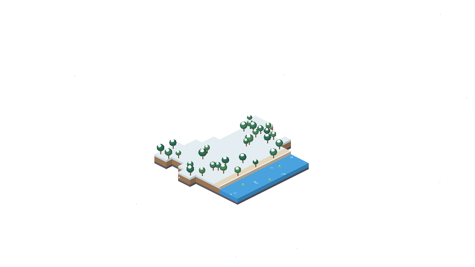</td>
    <td>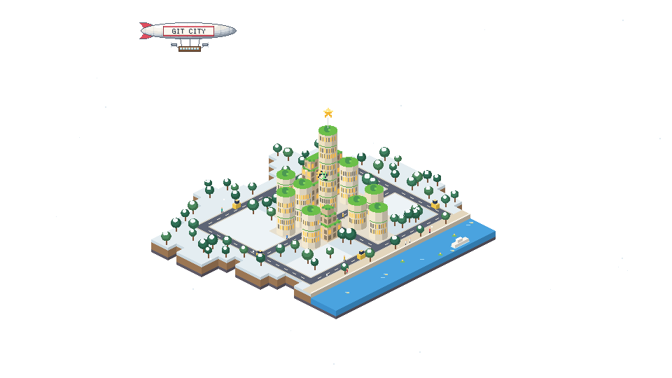</td>
    <td>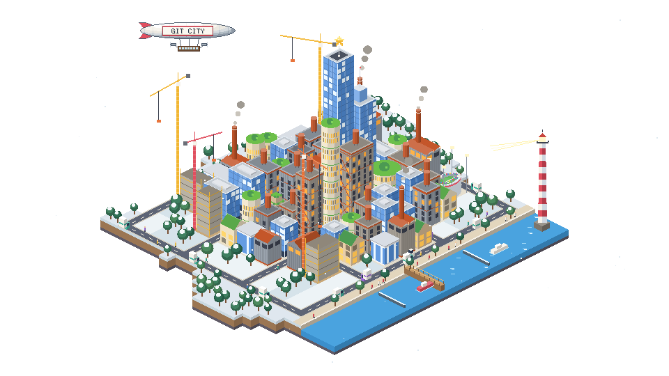</td>
  </tr>
  <tr>
    <td>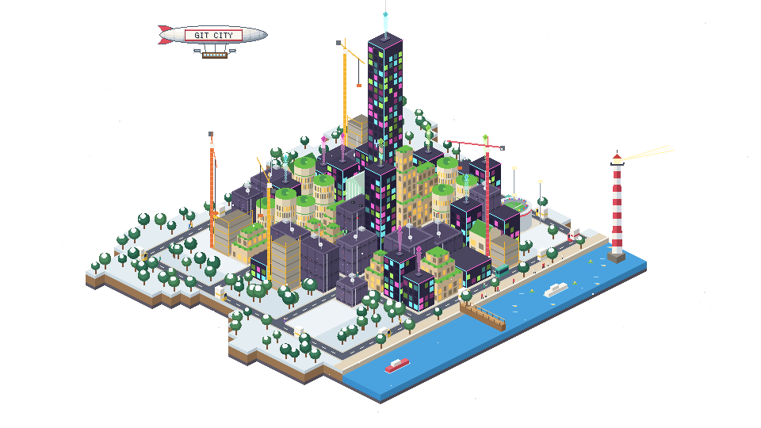</td>
    <td>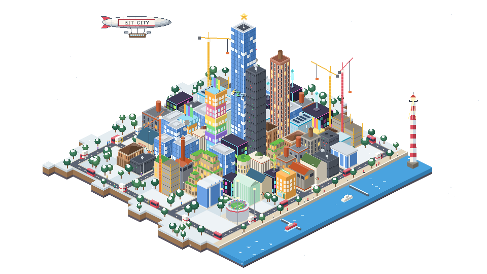</td>
    <td>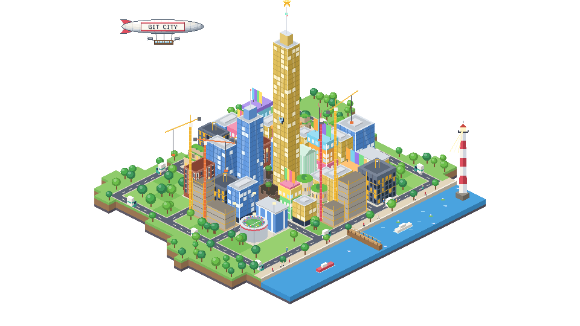</td>
  </tr>
  <tr>
    <td>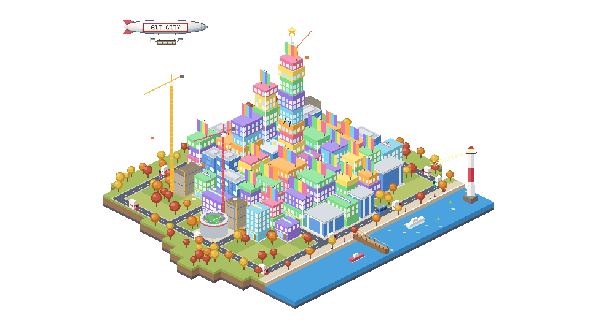</td>
    <td>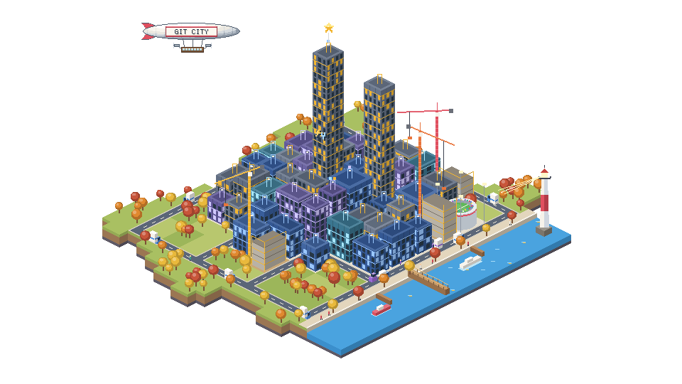</td>
    <td>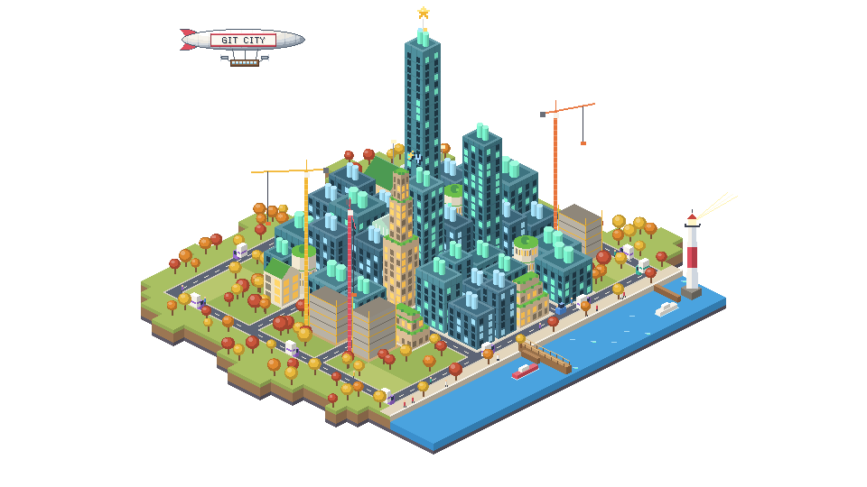</td>
  </tr>
</table>

### Four seasons

|                                Spring                                |                                  Summer                                   |                               Autumn                                |                                       Winter                                       |
| :------------------------------------------------------------------: | :-----------------------------------------------------------------------: | :-----------------------------------------------------------------: | :--------------------------------------------------------------------------------: |
| 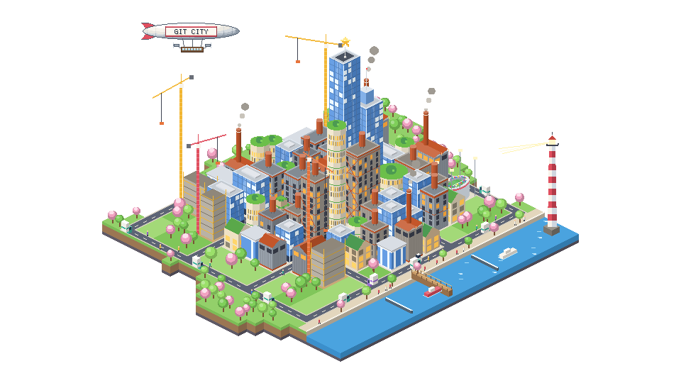 | 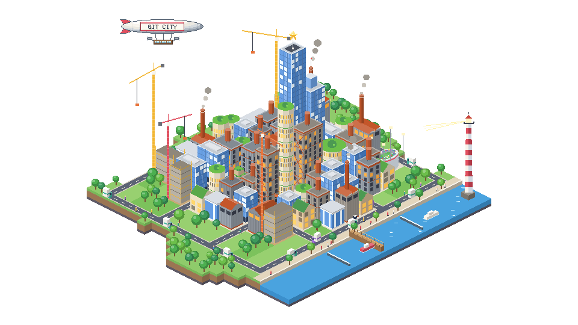 | 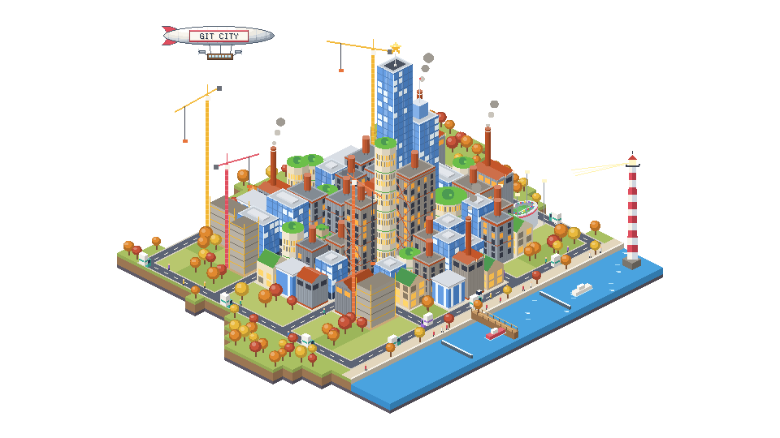 | 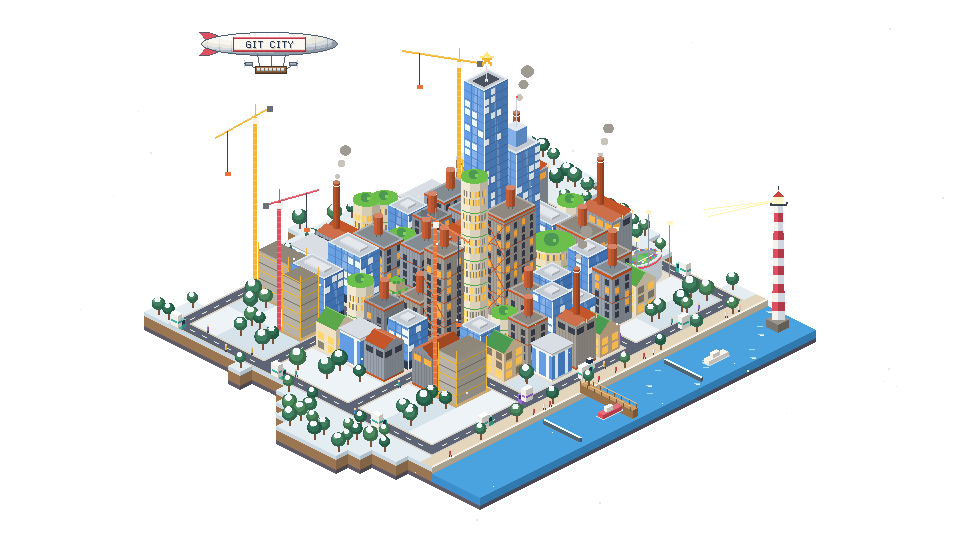 |

These static previews keep the same city and override only its visual season for comparison. In a generated city, the season is chosen by **when you committed the most**, not simply today's date. Winter GIFs also have falling snow.

### One city's lifecycle

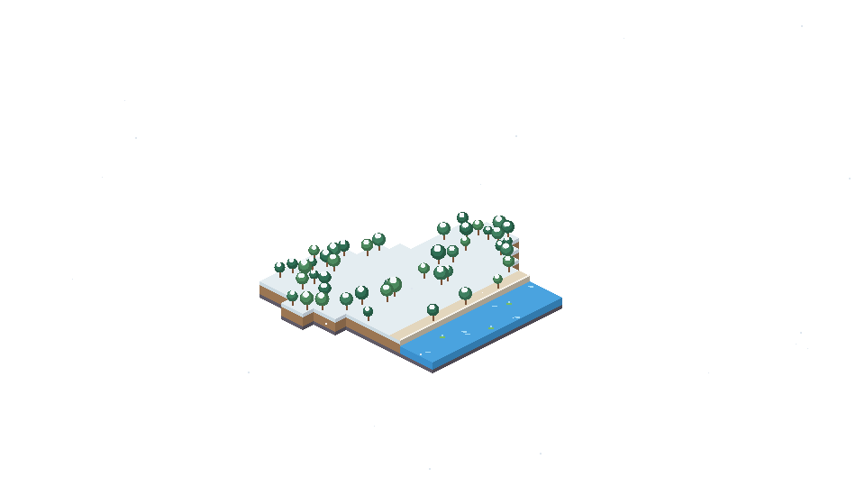

## Get started

### Generate a city locally

Requirements: **Node.js 22+** and **pnpm** (the version is pinned in [package.json](package.json)).

```bash
git clone https://github.com/soerenpriess/GitCity.git
cd GitCity
corepack enable
pnpm install --frozen-lockfile
pnpm build
node dist/src/cli.js generate --user YOUR_USERNAME --output assets/city.gif
```

This writes an animated GIF and a matching first-frame PNG. Public API access works without a token; set `GITHUB_TOKEN` to increase the rate limit.

Try an offline example without making API requests:

```bash
npx tsx src/cli.ts generate --user quiet-coder --input assets/examples/quiet.json --output assets/demo.gif
```

For a browser preview with mock activity and switchable backgrounds, run `pnpm dev`.

### Add a daily city to your GitHub profile

1. Open your public profile repository: `YOUR_USERNAME/YOUR_USERNAME`.
2. Copy [docs/git-city.yml](docs/git-city.yml) into that repository as `.github/workflows/git-city.yml`:

```yaml
name: Git City

on:
  schedule:
    - cron: "20 0 * * *" # Daily at 00:20 UTC
  workflow_dispatch:
  push:
    paths: [.github/workflows/git-city.yml]

permissions:
  contents: write

concurrency: git-city

jobs:
  city:
    runs-on: ubuntu-latest
    steps:
      - uses: actions/checkout@v7
      - uses: soerenpriess/GitCity@main
        with:
          output: assets/city.gif
```

3. Add this to your profile `README.md`:

```html
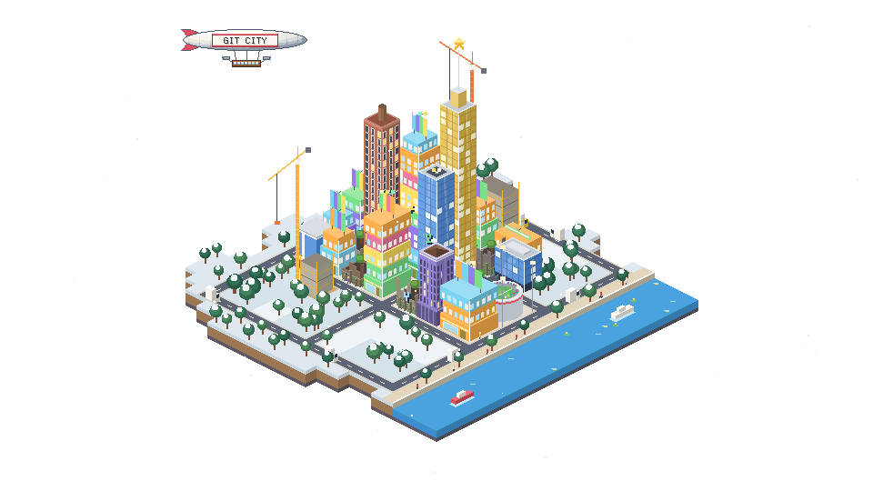
```

4. Push the workflow to the default branch. It starts on that push and runs daily afterwards. You can also use **Actions → Git City → Run workflow**. Scheduled runs may be delayed by GitHub.

## What shapes your city?

Raw counts are normalized with logarithmic scaling or bounded ratios, so both small and large profiles remain readable. A city is a visual interpretation, **not a one-pixel-per-contribution chart**.

| Input                                       | Effect on the city                                                                                                                    |
| :------------------------------------------ | :------------------------------------------------------------------------------------------------------------------------------------ |
| Commits in the selected period              | Taller skyline, more development, and a larger island                                                                                 |
| Commits in the last 30 days                 | More traffic and additional construction sites when free lots are available                                                           |
| Repository count                            | More projects to place, more development, and a larger island                                                                         |
| Commits per repository                      | Prioritize busy repositories in central lots and influence their building form and height                                             |
| Primary repository language                 | Architecture family and colors of that repository's building                                                                          |
| Language bytes across analyzed repositories | Weighted mix of surrounding buildings; the largest share chooses the waterfront theme                                                 |
| Secondary repository languages              | Up to three colored roof markers                                                                                                      |
| Stars                                       | The most-starred repository receives a larger landmark and golden star (usually a tower; libraries stay low); any stars bring a plane |
| Stars and forks                             | Together increase popularity, which adds pedestrians and helps grow the island                                                        |
| Followers                                   | More pedestrians and a larger island; at 20+ followers a stadium is placed when a free lot is available                               |
| Open issues and pull requests               | Maintenance activity contributes to traffic; issues create construction sites, while pull requests add delivery trucks                |
| Forks and distinct co-authors               | More boats; at least one co-author adds a bridge                                                                                      |
| Current commit streak                       | More pedestrians; activates the lighthouse beacon                                                                                     |
| Longest commit streak                       | At three or more days, adds a lighthouse whose height and red bands grow with the streak                                              |
| Commits grouped by season                   | Select spring, summer, autumn, or winter for ground and foliage                                                                       |
| Last push date                              | Repositories untouched for more than 365 days become ruins, except the starred landmark                                               |
| Repository age and recent pushes            | Also help choose zoning: residential, research, workshop, or nature                                                                   |
| Username, activity data, and optional seed  | Deterministic variations in lots, buildings, trees, and coastline                                                                     |
| No repositories and no commits              | An undeveloped meadow with trees and water, without roads, buildings, or traffic                                                      |

Changing the activity window or data can rearrange the city. `--seed` fixes the random variation, not the entire composition: island size, architecture, and decorations still respond to the statistics.

### Data scope and privacy

Git City lists up to **300 public repositories** through the GitHub REST API. The **15 most recently pushed repositories** receive detailed language, commit, issue, PR, and co-author analysis. Commit and open issue/PR requests are limited to up to 100 entries per analyzed repository; all listed repositories still contribute their stars and forks.

These are **not full account-wide contribution-calendar totals**. Private repositories are not included. Tokens are sent only to `api.github.com`, and no profile data is uploaded to another image service. Local API responses are cached for six hours; local JSON input makes no network requests.

If the API is unavailable or rate-limited, the CLI reports the cause and renders an empty meadow fallback. Partial repository failures produce warnings. An API failure can therefore produce a different GIF; the changed-output check compares the image, not whether the API request succeeded.

## Visual wiki

Use this as a legend when exploring your city. Not every building is a repository: **infill buildings** fill out the district using the profile's language distribution.

### Architecture atlas

These isolated examples use the actual building renderer. Forms, heights, facade variants, and rooftop details vary in full cities.

<table>
  <tr>
    <td valign="top">
      <table>
        <tr><th>Example</th><th>Family</th><th>Languages (examples)</th></tr>
        <tr>
          <td>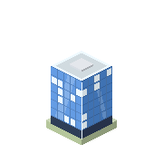</td>
          <td><strong>Glass</strong></td><td>TypeScript, JavaScript</td>
        </tr>
        <tr>
          <td>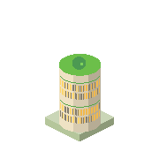</td>
          <td><strong>Eco</strong></td><td>Python, Jupyter Notebook, R, Julia</td>
        </tr>
        <tr>
          <td>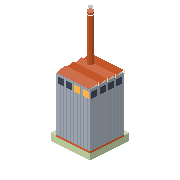</td>
          <td><strong>Industrial</strong></td><td>Rust, Zig</td>
        </tr>
        <tr>
          <td>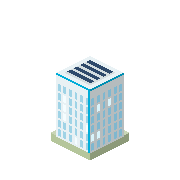</td>
          <td><strong>Functional</strong></td><td>Go, Dart, Swift</td>
        </tr>
        <tr>
          <td>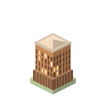</td>
          <td><strong>Monolith</strong></td><td>Java, Kotlin, Scala, C#</td>
        </tr>
        <tr>
          <td>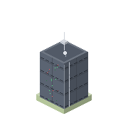</td>
          <td><strong>Technical</strong></td><td>C, C++, Objective-C, Assembly, CUDA, Fortran</td>
        </tr>
      </table>
    </td>
    <td valign="top">
      <table>
        <tr><th>Example</th><th>Family</th><th>Languages (examples)</th></tr>
        <tr>
          <td>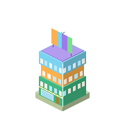</td>
          <td><strong>Creative</strong></td><td>HTML, CSS, Vue, Svelte, Astro, Ruby, PHP</td>
        </tr>
        <tr>
          <td>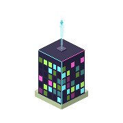</td>
          <td><strong>Neon</strong></td><td>GLSL, HLSL, WGSL, ShaderLab, Metal, Elixir, Erlang, Haskell</td>
        </tr>
        <tr>
          <td>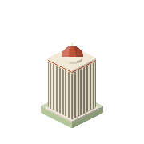</td>
          <td><strong>Library</strong></td><td>Markdown, MDX, TeX, reStructuredText, AsciiDoc</td>
        </tr>
        <tr>
          <td>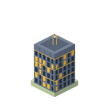</td>
          <td><strong>Operations</strong></td><td>Shell, Bash, PowerShell, Dockerfile, Nix, HCL, YAML</td>
        </tr>
        <tr>
          <td>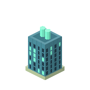</td>
          <td><strong>Data</strong></td><td>SQL, PL/SQL, GraphQL, Prisma, JSON</td>
        </tr>
        <tr>
          <td>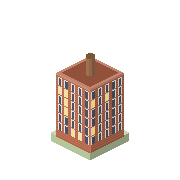</td>
          <td><strong>Brick</strong></td><td>Other or unrecognized languages</td>
        </tr>
      </table>
    </td>
  </tr>
</table>

The complete mapping and colors are in [languagePalette.ts](src/analysis/languagePalette.ts). A family can appear as a tower, mid-rise, house, or workshop; the atlas is illustrative, not an exhaustive sprite catalog.

### Landmarks, badges, and street life

| Element                               | Meaning                                                                               |
| :------------------------------------ | :------------------------------------------------------------------------------------ |
| **Golden star above a building**      | Most-starred repository; its landmark stays intact even when old                      |
| **Lightning facade badge**            | Repository with the most commits in the analyzed snapshot                             |
| **Sprout facade badge**               | Newest repository by creation date                                                    |
| **Fork facade badge**                 | Repository with the most forks                                                        |
| **Small colored roof markers**        | Up to three secondary languages, using their accent colors                            |
| **Green Vue roof mark**               | Identifies Vue architecture; distinct from language markers                           |
| **Lighthouse with red bands**         | Longest streak of at least three days; taller and more bands for longer streaks       |
| **Rotating lighthouse beacon**        | A current streak is running                                                           |
| **Roofless masonry, rubble, and ivy** | Abandoned repository: no push for more than a year                                    |
| **Scaffolding and cranes**            | Work in progress, driven by open issues and recent activity                           |
| **Delivery trucks**                   | Open pull requests                                                                    |
| **Pedestrians**                       | Community, popularity, and current streak; some appear even in a small populated city |
| **Stadium with a crowd wave**         | At least 20 followers, subject to free lot capacity                                   |
| **Cars**                              | Recent activity and maintenance; they follow looping streets                          |
| **Boats**                             | Forks and collaboration add river traffic                                             |
| **Bridge**                            | At least one distinct co-author                                                       |
| **Plane**                             | The profile has stars; not a separate repository                                      |
| **“GIT CITY” zeppelin**               | Application branding on every populated city, **not** a statistic or username label   |
| **Parks and meadow lots**             | Undeveloped land or nature zoning; not a one-to-one inactivity score                  |
| **Lit windows and blinking lights**   | Architecture and animation details; not a direct count of commits or streak days      |
| **Bays and island outcrops**          | Seeded variation, not geography inferred from your profile                            |

### Waterfronts and seasons

| Visual                      | Meaning                                         | See it                                                                                         |
| :-------------------------- | :---------------------------------------------- | :--------------------------------------------------------------------------------------------- |
| **Harbor with piers**       | Dominant language belongs to operations or data | [Shell harbor](assets/examples/shell-harbor.png), [SQL harbor](assets/examples/sql-harbor.png) |
| **Garden waterfront**       | Dominant language belongs to eco or creative    | [Vue garden](assets/examples/vue-garden.png)                                                   |
| **Canal with locks**        | Other dominant architecture families            | [Polyglot city](assets/examples/polyglot.png)                                                  |
| **Spring blossoms**         | Most commits fell in March–May                  | [Spring preview](assets/wiki/season-spring.png)                                                |
| **Summer green**            | Most commits fell in June–August                | [Summer preview](assets/wiki/season-summer.png)                                                |
| **Autumn foliage**          | Most commits fell in September–November         | [Autumn preview](assets/wiki/season-autumn.png)                                                |
| **Snow and falling flakes** | Most commits fell in December–February          | [Winter preview](assets/wiki/season-winter.png)                                                |

Seasons use northern-hemisphere meteorological months.

## Repository structure

```text
GitCity/
├── .github/workflows/       Daily city update in this repository
├── assets/
│   ├── examples/           Fictional snapshots, GIFs, PNGs, lifecycle
│   ├── wiki/               Seasonal comparisons and architecture atlas
│   └── palettes.json       Palette reference
├── scripts/                Reproducible showcase and README image generators
├── src/
│   ├── action/             Changed-output comparison helper
│   ├── analysis/           Metric normalization, streaks, language styles
│   ├── city/               Grid, zoning, buildings, seasons, monument, traffic
│   ├── github/             REST client, caching, public activity aggregation
│   ├── render/
│   │   └── architecture/   Family renderers and repository ruins
│   ├── cli.ts              CLI entry point
│   └── main.ts             Browser preview with mock activity
├── tests/                  Model, rendering, GIF, Action, and showcase tests
├── action.yml              Reusable composite GitHub Action
├── git-city.yml            Profile workflow to copy
└── package.json            Commands and dependencies
```

### Development and contributing

```bash
pnpm dev               # Browser preview
pnpm test              # Test suite
pnpm lint              # ESLint
pnpm build             # TypeScript and browser build
pnpm examples:showcase # Theme examples and lifecycle GIF/PNGs
pnpm examples:readme   # Four seasonal PNGs and architecture atlas
```

## License

[MIT](LICENSE).
